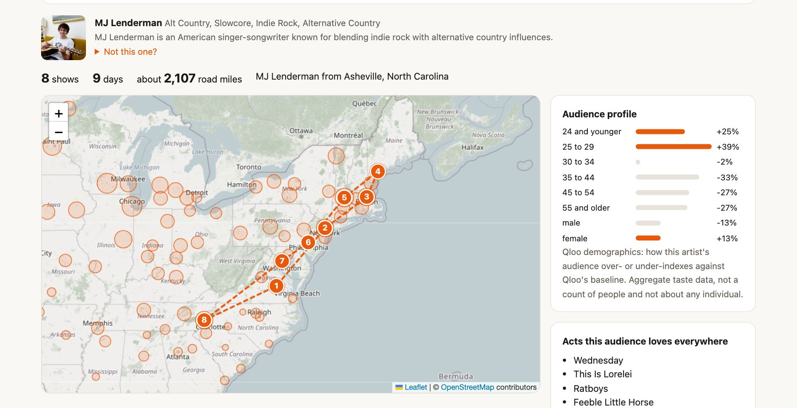
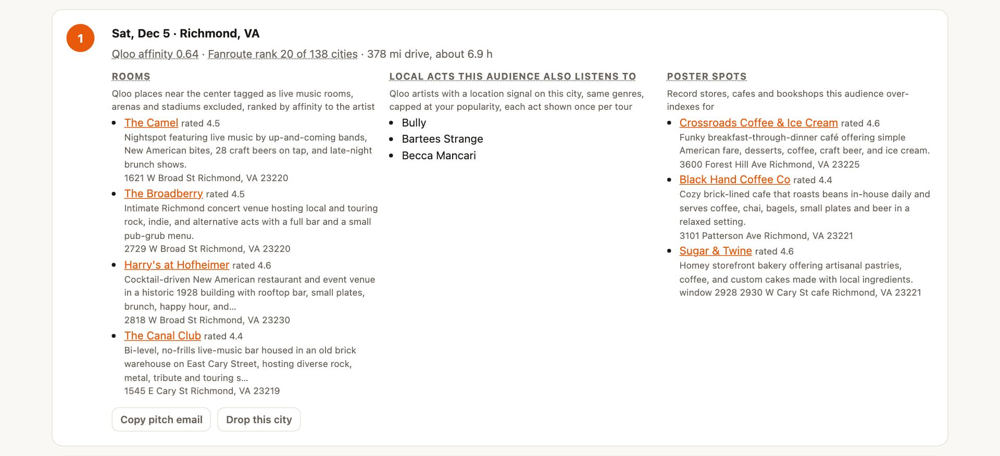
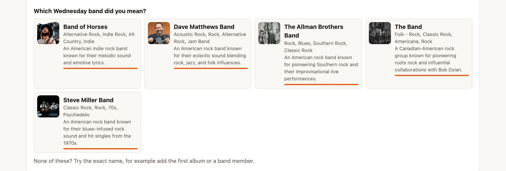
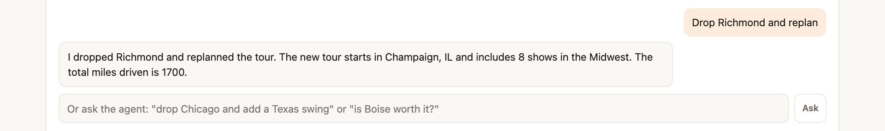

# Fanroute

Tour the cities where your audience already over-indexes. Type an artist and a home city. Fanroute asks Qloo where
that artist's audience over-indexes across 138 US touring cities, routes the best of them into a loop a van can
actually drive, and for every stop finds small rooms, local acts and poster spots that the same audience already
likes. A chat agent can change the plan ("drop Chicago", "is Boise worth it?") with the same Qloo-backed tools.

Live: https://fanroute.akhil-1527.workers.dev (click "Try an example" for a full plan in about ten seconds)





Built for the Qloo Agentic Hackathon, 2026.

## The problem

Independent artists route their own tours. Most pick cities by gut feel, by where friends live, or by copying a bigger
band's routing, then spend weeks emailing rooms that were never a fit. The data that says where an artist's audience
over-indexes, which rooms that audience goes to and which local acts it also listens to exists, but nobody puts it on
a map next to a van route and a stack of booking emails.

## How Fanroute uses Qloo

Every city, room, act, brand and podcast on the page comes from a Qloo request. Without Qloo the app is a map and a
travelling-salesman loop.

| Request | Question it answers in the product | Why this endpoint and these parameters |
|---|---|---|
| `/search`, `types=urn:entity:artist`, `take=5` | Which artist do you mean? | Five candidates let the page ask "which one?" when the top match isn't the name typed |
| `/search`, `types=urn:entity:locality` | Where is home? | US results only, shown as "City, State" so a wrong Portland is visible |
| `/v2/insights`, `filter.type=urn:heatmap` | Where does this artist's audience over-index? | Heatmap cells over small boxes around each touring city, three calls cover all 138 |
| `/v2/insights`, `urn:entity:place`, live music tags | Which rooms in this city fit this artist? | Four venue tags with `operator.filter.tags=union`, big rooms removed with `filter.exclude.tags` |
| `/v2/insights`, `urn:entity:place`, shop tags | Where do the posters go? | Record stores, cafes and bookshops near the center, ranked by affinity |
| `/v2/insights`, `urn:entity:artist`, `signal.location` | Who could open the show locally? | The headliner's genre tags, a popularity cap, and the city as a location signal |
| `/v2/insights`, `urn:entity:artist`, no location | Who could share a package tour? | Same call without the location signal: acts this audience likes everywhere |
| `/v2/insights`, `urn:demographics`, `urn:entity:brand`, `urn:entity:podcast` | Who is the audience, who might sponsor, where to pitch press? | The artist as the only signal |

An 8-show plan makes 33 Qloo requests and a 14-show plan makes 51. The page lists every one of them under "Under the
hood", with the parameters it sent, so a reader can check any pick against the request that produced it.

## From a request to a result

Worked example: MJ Lenderman from Asheville, NC, 8 shows (the "Try an example" button). Requests are shown without the
key, which only ever travels in the `X-Api-Key` header.

1. **Match the artist.** `GET /search?query=MJ Lenderman&types=urn:entity:artist&take=5`. The top result's name matches
   the query, so the plan goes ahead and the other four candidates sit behind "Not this one?". For "Wednesday band" the
   top result is Band of Horses, so the planner stops after this one request and shows a picker instead of planning a
   tour for the wrong band. The artist's genre tag ids (8 for MJ Lenderman, among them alt country, slowcore, indie
   rock and americana) are kept for step 5.
2. **Find home.** `GET /search?query=Asheville, North Carolina&types=urn:entity:locality&take=4`. Postal codes are
   spelled out first because Qloo search reads "Portland, Maine" but resolves "Portland, ME" to a neighborhood.
3. **Rank the cities.** Three heatmap requests, one per 50 cities, west to east:
   `GET /v2/insights?filter.type=urn:heatmap&filter.location=MULTIPOLYGON(((-82.589 35.570,...)),...)&signal.interests.entities=<id>`.
   Why boxes: a city boundary entity as `filter.location` returned 500, the whole-US grid is 2.3 MB and ignores `take`,
   and all 138 boxes in one URL hit a 414. Each box is about 4 by 4 miles on the city center. A city's Qloo affinity is
   the mean affinity of the heatmap cells inside its box. Fanroute's score is that affinity times the square root of
   the cells' mean popularity, so a big market with a good affinity beats a tiny town with a slightly better one.
4. **Route.** Only the top third of ranked cities are candidates, because real affinity spreads are narrow and short
   drives would otherwise win every time. Cities are added by score per added mile, every leg (including the drive home)
   stays within two driving days, no two shows are within 50 miles (the usual radius clause), and a 2-opt pass uncrosses
   the loop (`src/route.js`).
5. **Fill each stop.** Three requests per stop:
   - Rooms: `filter.type=urn:entity:place`, `filter.tags` = live_music_venue, live_music_bar, concert_hall and the
     music_venue setting tag, joined with `operator.filter.tags=union`, `filter.exclude.tags` = arena, stadium,
     amphitheater, fairground, farm, sports bar, museum, opera company, visitor center and a few more, within 30 km,
     ranked by affinity to the artist. A description check then drops anything described as an arena or stated at
     2,500 seats or more. The check reads the description, never the name: Hardcore Stadium in Cambridge is a 100-cap
     DIY room and stays.
   - Local acts: `filter.type=urn:entity:artist`, `signal.location=POINT(lon lat)`, `filter.tags` = the headliner's
     genre tag ids with `operator.filter.tags=union`, `filter.popularity.max` = the headliner's popularity, `take=8`.
     Before the genre filter, Trixie Mattel showed up as an opener for MJ Lenderman; after it, Lydia Loveless, SUSTO and
     Palehound did. Across the tour each act goes to the one stop where it scores highest, so the same name doesn't
     fill every stop (Kim Gordon used to).
   - Poster spots: record_store, coffee_shop and book_store tags within 15 km.
6. **Profile the audience.** Demographics, brands, podcasts, and the local-acts request without a location signal,
   which lists acts this audience likes everywhere (for MJ Lenderman: Wednesday, This Is Lorelei, Ratboys, Feeble Little
   Horse). Comparing that list with the per-stop lists shows the location signal doing real work.

Each distinct request is cached for a day, so a second run of the same plan comes back in under a second.

**Fitting the Cloudflare free plan.** A Worker invocation gets 10 ms of CPU, and a heatmap chunk or one stop's places
are a few hundred KB of JSON to parse. Those heavy steps run through a service binding back into the same Worker
(`Split` in `src/index.js`), so each one gets its own CPU budget. Requests leave at least 220 ms apart to stay under the
key's 5 calls a second; a 429 waits a second and retries, a 5xx retries once, and one failed heatmap chunk shrinks the
ranking instead of failing the plan.

**The chat agent** runs Llama 3.3 70B on Workers AI with two tools, `plan_tour` and `check_city`. It only sees the
plan's names and numbers, never raw payloads, and its tool arguments pass through the same bounds as the form.

## Screenshots

| | |
|---|---|
|  | The route over every ranked city. Circle size is Fanroute's score. |
|  | One stop: Qloo affinity and Fanroute rank side by side, rooms, local acts, poster spots, a pitch email to copy. |
|  | "Wednesday band" matches Band of Horses first, so the page asks which artist was meant. |
|  | The agent replans the tour through the same tools. |

## Run it

Needs Node 20 or newer. No packages to install.

```
node dev.js        # http://localhost:8788 with fake Qloo data and a fake chat model, no key needed
npm run check      # routing, artist matching, dedupe, room and city checks
```

For real data, copy `.dev.vars.example` to `.dev.vars`, put your Qloo key in it, and run `node dev.js` again.

Deploy to Cloudflare Workers (the free plan is enough; wrangler 4 needs Node 22):

```
npx wrangler secret put QLOO_API_KEY
npx wrangler deploy
```

Set `QLOO_API_URL` the same way only if Qloo gave you a server other than `https://hackathon.api.qloo.com`.

## Limits and what the result does not establish

- Qloo affinity is aggregate taste data: where an artist's audience over-indexes compared with Qloo's baseline. It is
  not ticket demand, not attendance, not a count of people, and it says nothing about any individual.
- Fanroute rank is Fanroute's own ordering (affinity weighted by popularity), not a Qloo output. The route, the room
  order and the pitch text are Fanroute's interpretation too.
- Room size isn't in the data. Big rooms are removed by Qloo tags and by what the description says, so a mis-tagged
  big room with a plain description can still slip through, and some places that host music but aren't really venues
  (a lounge, a cafe) show up.
- Qloo popularity is a percentile, so the cap on local acts only removes acts clearly bigger than the headliner. A
  famous act at the same percentile can still appear.
- An artist with no genre tags in Qloo gets local acts without the genre filter.
- 138 cities in the contiguous US. A city not on the list can't be routed, though the chat agent can still check it.
- Road miles are straight-line miles times 1.2, so drive times are rough.
- Dropping a city replans the whole loop rather than patching one leg.
- The chat agent only states what its tools return, but a language model can still misread a result.
- Results are cached for 24 hours, and the hackathon key has a monthly quota.

## Responsible use

- Of what a user types, only the artist name and the home city go to Qloo. Nothing personal is sent or stored.
- Pitch emails are built in the browser and copied to the clipboard; nothing is sent on anyone's behalf.
- Model output is treated as untrusted: tool arguments are bounded and validated (shows, miles, dates, city lists,
  artist ids), and everything shown on the page is escaped.
- Every number is labelled with its source, Qloo or Fanroute, and the footer says what the numbers are not.

## License

MIT
